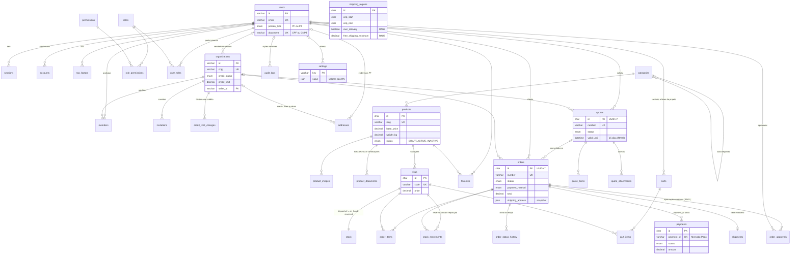

# Atelier Bureau — Diagrama ER

Modelo de dados da issue #8 (RNF16). A fonte da verdade é o [`prisma/schema.prisma`](../prisma/schema.prisma). Este diagrama mostra as entidades e os relacionamentos principais; colunas de auditoria (`created_at`, `updated_at`, `deleted_at`) foram omitidas.

Convenções: tabelas e colunas em inglês e `snake_case`, dinheiro em `DECIMAL(12,2)`, datas em `DATETIME(3)` (UTC), charset `utf8mb4` com collation `utf8mb4_0900_ai_ci`, e `id` em UUID v7 nas entidades expostas em URL (pedido, cotação).

## Tabelas

| Grupo | Tabelas | Requisitos |
|---|---|---|
| Autenticação (Better Auth) | `users`, `sessions`, `accounts`, `verifications`, `two_factors` | RF39, RF40 |
| Contas corporativas | `organizations`, `members`, `invitations`, `credit_limit_changes` | RF09, RF10, RF58, RN08, RN10, RN11 |
| Perfis internos (RBAC) | `roles`, `permissions`, `role_permissions`, `user_roles` | RF55 |
| Endereços | `addresses` | RF26 |
| Catálogo | `categories`, `products`, `product_images`, `product_documents`, `skus`, `favorites` | RF01–RF03, RF41, RF42, RF45, RN09 |
| Estoque | `stock`, `stock_movements` | RF43, RF44, RN14 |
| Carrinho e cotação | `carts`, `cart_items`, `quotes`, `quote_items`, `quote_attachments` | RF05–RF08, RF20, RF51, RF52, RN02 |
| Pedido, pagamento e frete | `orders`, `order_items`, `order_status_history`, `payments`, `shipments`, `shipping_regions` | RF11, RF15, RF25–RF33, RF54, RN01, RN13, RN15, RN16, RN20, RN23 |
| Configuração e auditoria | `settings`, `audit_logs` | RN01, RN06, RN14, RN16, RN20, RNF12 |
