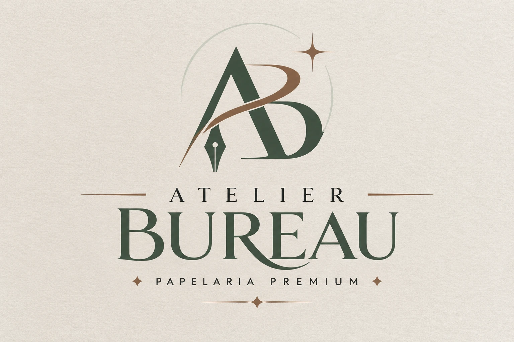

# Atelier Bureau — Identidade visual e logo

Registro da decisão da logo oficial (issue #14, AB-014) e das regras de uso no site. As cores e a tipografia de interface continuam vindo de `app/tokens.css` (#13, RNF15).

## Decisão

Em 17/11/2026 adotamos como logo oficial a composição com o **monograma AB**, a pena e o nome **ATELIER BUREAU** com a assinatura **PAPELARIA PREMIUM**. Ela substitui o logo provisório em texto usado desde o início do projeto e o símbolo antigo, que tinha leitura de botão “+” ou de farmácia.

## Por que escolhemos esta logo

A direção visual foi pensada para uma papelaria premium e precisa transmitir sofisticação, exclusividade e elegância artesanal, que é o posicionamento de boutique high ticket da loja.

- **Monograma AB exclusivo.** As iniciais entrelaçadas formam um símbolo próprio, fácil de reconhecer e que funciona sozinho em espaços pequenos (favicon, ícone de app, menu). Ele resolve o problema do símbolo anterior, que lembrava um “+” ou uma cruz de farmácia.
- **Pena e traço caligráfico.** A ponta de caneta-tinteiro no fim da perna do “A” e o traço em cobre que liga as letras remetem à escrita à mão, ao produto principal da loja (papelaria nobre) e ao trabalho artesanal.
- **Tipografia serifada editorial.** O nome em serifa clássica, com espaçamento largo no “ATELIER”, conversa com a Playfair Display usada nos títulos do site e reforça a estética editorial do design system “Warm Editorial Atelier”.
- **Detalhes ornamentais contidos.** A estrela de quatro pontas, os filetes e os losangos dão o acabamento de boutique de luxo sem pesar a composição.
- **Paleta coerente com o site.** As cores da logo são as mesmas do design system, então a marca e as telas formam uma identidade única, sem cores soltas.

## Paleta oficial

| Papel | Cor | Uso | Token em `app/tokens.css` |
|---|---|---|---|
| Primary | `#4A6353` | Monograma e nome “BUREAU” | `--ab-primary` |
| Secondary | `#8C6A58` | Traço caligráfico, estrela e ornamentos | `--ab-secondary` usa `#7A5C4C` em texto, para atingir contraste AA (#13) |
| Tertiary | `#DCE5DD` | Arco de fundo do monograma e superfícies suaves | `--ab-primary-tint` |
| Neutral | `#1E2221` | “ATELIER” e “PAPELARIA PREMIUM” | `--ab-text-primary` |

O terracota original `#8C6A58` fica na logo, onde é elemento gráfico. Em texto da interface vale o tom ajustado `#7A5C4C`.

## Versões e onde cada uma aparece

| Versão | Arquivo | Onde |
|---|---|---|
| Original (referência) | `docs/marca/atelier-bureau-logo.webp` | Esta documentação |
| Completa (empilhada) | `public/brand/atelier-bureau-logo.png` | Rodapé da loja |
| Monograma | `public/brand/atelier-bureau-monogram.png` | Cabeçalho da loja, menu mobile e back office, ao lado do nome em Playfair Display |
| Favicon 32 px | `app/icon1.png` | Aba do navegador |
| Ícone 512 px | `app/icon2.png` | Ícone em alta resolução |
| Apple touch 180 px | `app/apple-icon.png` | Atalho na tela inicial do iOS |

No site, a logo é sempre usada pelo componente `components/brand/brand-logo.tsx`:

- `<BrandLogo />`: versão horizontal (monograma + nome), legível a partir de 24 px de altura.
- `<BrandLogo size="compact" />`: versão horizontal em tamanho fixo, para menus e barras estreitas.
- `<BrandLogo variant="full" />`: logo completa, para áreas com espaço (rodapé).

Os PNGs foram gerados com `sharp` a partir da arte aprovada, com o fundo de papel removido. Os favicons usam o fundo `#FBF9F5` (`--ab-surface-canvas`) para manter o contraste em abas escuras.

## Regras de uso

- Não alterar as cores, as proporções nem a posição dos elementos.
- Não usar a logo completa abaixo de 120 px de largura: nesse caso, use a versão horizontal ou só o monograma.
- Manter uma área livre em volta da logo de pelo menos a altura da letra “B” do monograma.
- Aplicar sobre fundos claros do design system (`canvas` ou `subtle`). Uma versão negativa para fundo escuro ainda não existe.

## Pendências

- Versões vetoriais (SVG) com texto em curvas e as variantes negativa e monocromática dependem do arquivo-fonte vetorial da arte. Quando ele existir, os PNGs de `public/brand/` são trocados pelos SVGs sem mudar o componente.
- Os e-mails transacionais (`emails/layout.ts`) continuam com o nome em texto, porque imagem em e-mail precisa de URL pública absoluta.
