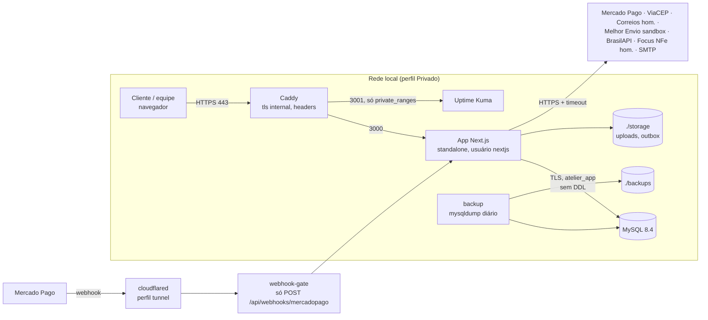
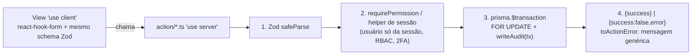

# Mapa arquitetural do Atelier Bureau

Feito em 18/11/2026, por leitura do código da `develop` (com o PR #218). Cada afirmação cita o arquivo de onde veio. Este é o ponto de partida obrigatório antes de qualquer mudança estrutural.

## 1. Visão geral

E-commerce B2B + B2C de papelaria e mobiliário executivo. É um **monólito modular** em Next.js 16 (App Router), com lógica em Server Actions, dados em MySQL 8.4 via Prisma 7 e servidor local em Docker.



## 2. Camadas e organização

| Camada | Onde | Regra | Situação verificada |
|---|---|---|---|
| Rotas | `app/` | `page.tsx` só renderiza a `<Feature>View` | Cumprida. Exceção: `app/media/[...key]/route.ts` usa Prisma direto |
| Middleware | `proxy.ts` | Request id, rate limit em memória, CSP com nonce no pagamento | Rate limit por `X-Forwarded-For`. Ver o risco do Docker Desktop (seção 7) |
| Features | `features/<domínio>/<feature>/{view, action/, schema/}` | Nunca importar outra feature | **Nenhum import cruzado** encontrado |
| Compartilhado | `features/shared/lib/*` | Serviços, integrações (`server-only`), db, auth | 4 arquivos de Server Action fora de `action/` (cart, favorites, shipping, cep) |
| UI genérica | `components/` | Apresentação pura (shadcn `base-nova`) | — |
| Dados | `prisma/` | Schema, 29 migrations, seed, gatilhos | 52 models, `@@map`/`@map` em todos, nenhum `Float` |
| Infra | `docker-compose.yml`, `Dockerfile`, `deploy/` | proxy, app, db, backup, uptime-kuma, túnel opcional | Todos com healthcheck e `restart: unless-stopped` |

### Domínios (11) e features (49)

| Domínio | Features | Rotas principais |
|---|---|---|
| access | sign-in, sign-up, password-reset, security (2FA), corporate-members | `/entrar`, `/cadastro`, `/recuperar-senha`, `/conta/seguranca`, `/conta/usuarios`, `/convite/[id]` |
| account | overview, addresses, favorites, privacy | `/conta`, `/conta/enderecos`, `/conta/favoritos`, `/conta/privacidade` |
| catalog | listing, product-page, compare, categories, products-admin | `/busca`, `/categoria/[slug]`, `/produto/[slug]`, `/comparar`, `/admin/produtos` |
| cart | cart-page, project-lists, quote-request, customer-quotes, quote-management, price-tables | `/carrinho`, `/cotacao/nova`, `/conta/cotacoes`, `/admin/cotacoes`, `/admin/precos` |
| payment | checkout, order-payment, installments | `/checkout`, `/conta/pedidos/[id]/pagamento`, `/admin/parcelamento` |
| orders | order-tracking, address-change, order-approval, order-management, stock | `/conta/pedidos/[id]`, `/conta/aprovacoes`, `/admin/pedidos`, `/admin/estoque` |
| shipping | regions, manual-quotes | `/admin/frete`, `/admin/cotacoes-frete` |
| finance | finance-home, credit-approval, invoiced-billing, refunds, invoices | `/admin/financeiro/*`, `/admin/nfe` |
| after-sales | seller-contact, support-tickets, support-desk, demo-scheduling, demo-desk, seller-routing | `/atendimento`, `/conta/chamados`, `/admin/atendimento`, `/demonstracao` |
| backoffice | home, shell, audit-log, home-content, institutional-pages, internal-users, privacy-requests, promotions | `/admin`, `/admin/auditoria`, `/admin/conteudo`, `/admin/usuarios`, `/admin/lgpd`, `/admin/promocoes` |
| app | home, institutional, components, shell | `/`, `/garantia`, `/politica-de-privacidade`, `/termos-de-uso`, `/trocas-e-devolucoes` |

Rotas de API: `app/api/webhooks/mercadopago`, `app/api/health` e `app/api/csp-report`. O Better Auth não expõe `/api/auth/*`: ele é chamado só por `auth.api.*` dentro das actions.

## 3. Padrão de Server Action



Peças centrais:
- `features/shared/lib/db/permissions.ts:60-74`: `requirePermission`.
- `features/shared/lib/db/corporate.ts`: `requireCorporatePermission`.
- `features/shared/lib/db/audit.ts:38`: `writeAudit`.
- `features/shared/lib/errors/action-result.ts:43`: `toActionError`.
- `features/shared/lib/orders/order-lifecycle.ts:89-166`: `transitionOrder`, a máquina de estados do pedido.
- `features/shared/lib/stock/stock-service.ts:29-54`: `lockStockRows`, com `SELECT ... ORDER BY sku_id FOR UPDATE`.

## 4. Ciclo de vida do pedido

```mermaid
stateDiagram-v2
  [*] --> AWAITING_SHIPPING_QUOTE: frete manual (RN20)
  [*] --> AWAITING_APPROVAL: PJ acima do RN01
  [*] --> AWAITING_PAYMENT
  AWAITING_SHIPPING_QUOTE --> AWAITING_APPROVAL
  AWAITING_SHIPPING_QUOTE --> AWAITING_PAYMENT
  AWAITING_APPROVAL --> AWAITING_PAYMENT: aprovador
  AWAITING_APPROVAL --> PAID: faturado com crédito
  AWAITING_PAYMENT --> PAID: Mercado Pago approved + valor exato
  AWAITING_PAYMENT --> CANCELED: expiração RN14 (job 1 min)
  PAID --> IN_PRODUCTION
  IN_PRODUCTION --> SEPARATING
  SEPARATING --> SHIPPED --> DELIVERED
  PAID --> CANCELED
  PAID --> REFUNDED: estorno total
```

Efeitos das transições:
- **Ao entrar em PAID:** baixa definitiva do estoque (WRITE_OFF), parcelas 28/56 quando o pagamento é faturado e NF-e na fila.
- **Ao entrar em CANCELED:** só libera as reservas. Cancelar depois de PAID não devolve o estoque; ver o achado na auditoria de qualidade.

## 5. Integrações

| Integração | Arquivo | Ambiente | Timeout | Fallback | Trava de produção |
|---|---|---|---|---|---|
| Mercado Pago (pagamento, estorno, webhook, reconciliação) | `features/shared/lib/mercadopago/` | sandbox (`TEST-`) | 10 s | pagamento online desligado; reconciliação a cada 5 min | **Sim** (`MERCADOPAGO_ALLOW_PRODUCTION`) |
| ViaCEP | `features/shared/lib/viacep/` | API pública | 3 s | digitação manual | — |
| Correios | `features/shared/lib/correios/` | homologação | 5 s | próxima estratégia ou cotação manual | Não |
| Melhor Envio | `features/shared/lib/carrier/` | sandbox | 8 s | cotação manual | Não |
| BrasilAPI CNPJ | `features/shared/lib/brasilapi/` | pública, URL fixa | 5 s | segue com os dados digitados | — |
| Focus NFe | `features/shared/lib/nfe/` | homologação | 15 s | nova tentativa em 1/5/15/60/240 min | **Não** |
| SMTP | `features/shared/lib/email/` | sem `SMTP_HOST` grava em `storage/outbox` | 10–20 s | fila `email_outbox` com 5 tentativas | Não (o fallback para arquivo vale em qualquer ambiente) |

## 6. Jobs em processo (`instrumentation.ts` → `features/shared/lib/jobs/app-jobs.ts`)

| Job | Intervalo |
|---|---|
| expirar pedidos não pagos | 1 min |
| reconciliar pagamentos | 5 min |
| fila de e-mail | 30 s |
| expirar cotações | 10 min |
| fila de NF-e | 1 min |
| limpar rate limit | 30 min |

Os jobs usam `setInterval` no processo, sem lock entre réplicas. O PR #219 introduz um cluster de 4 workers e precisa garantir que os jobs rodem em um único processo.

## 7. Acoplamento, escalabilidade e débitos técnicos

| Tema | Achado | Evidência | Impacto |
|---|---|---|---|
| Acoplamento | Baixo entre features: nenhum import cruzado. O acoplamento está em `features/shared/lib` (≈40 módulos), que funciona como o "núcleo de domínio" | varredura de imports | Mudanças em `shared` afetam vários domínios. Mitigado pelos testes |
| Escalabilidade | Estado em memória: rate limit do `proxy.ts`, cache de token dos Correios, jobs com `setInterval` | `proxy.ts:16`, `correios.ts:94-153`, `scheduler.ts` | Não escala horizontalmente sem lock e store compartilhados (o #219 trata em parte) |
| Escalabilidade | Rate limit por IP, e no Docker Desktop todo cliente chega pelo IP do gateway | `docker-compose.yml:65-68`, `proxy.ts:27-30` | Um cliente pode esgotar o limite de login de todos (inferência, a confirmar) |
| Débito | Zod inline e permissão antes do Zod em algumas actions | `product-actions.ts:69-80, 132, 437, 492, 526, 577`; `favorite-actions.ts:49`; `manual-quote-actions.ts:66`; `home-content-actions.ts:98-110` | Viola o CLAUDE.md §5–6 |
| Débito | Server Actions fora de `action/` | `features/shared/lib/{cart,favorites,shipping,viacep}/*-actions.ts` | Viola a convenção |
| Débito | Settings das RN sem tela de edição | `seed-data.ts:22` diz "editable in the back office" | Mudar RN01/RN06/RN14/RN20 exige mexer no banco, o que a política proíbe |
| Débito | Textos "28/56" fixos na UI | `credit-approval-view.tsx:365`, `finance-home-view.tsx:27`, `refunds-view.tsx:68`, `home-content.ts:75` | Divergem se o setting mudar |
| Débito | Testes de integração fora do CI; E2E com um único arquivo | `.github/workflows/*` | Regressões de fluxo crítico passam sem detecção |
| Débito | Sem TODO/FIXME no código | grep | — |

Os achados de segurança, qualidade e documentação ficam nos relatórios próprios desta pasta.
