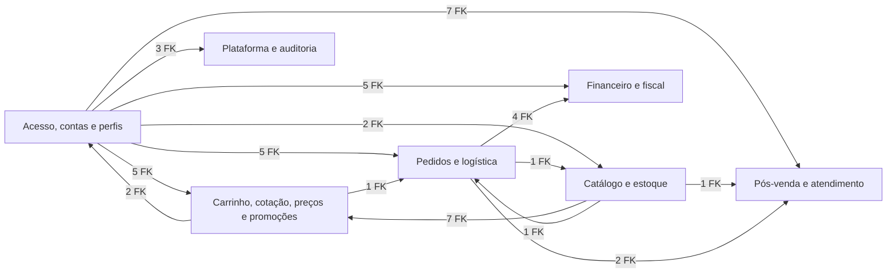
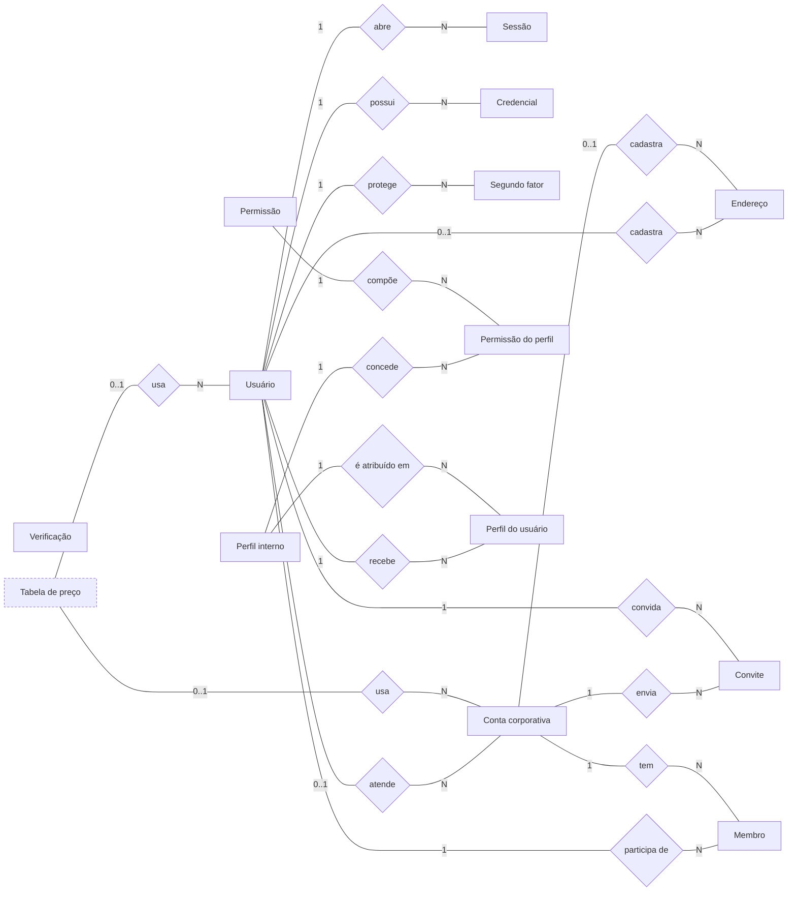
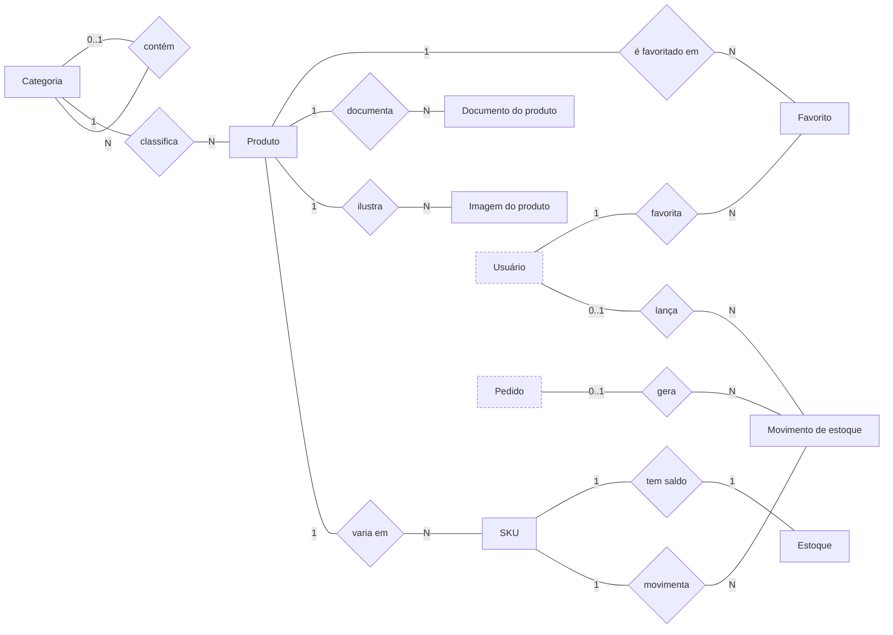
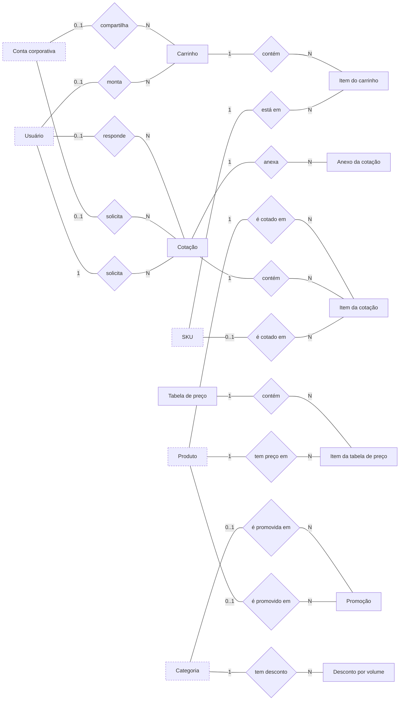
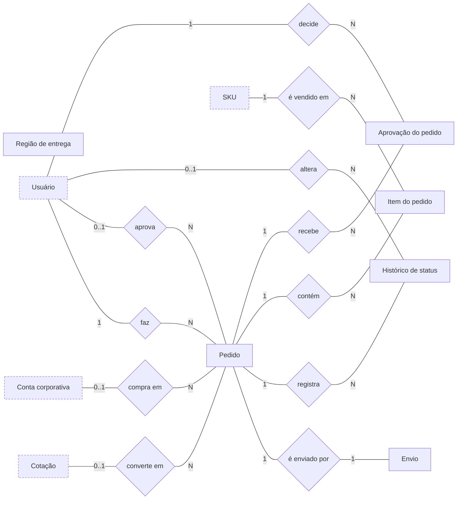
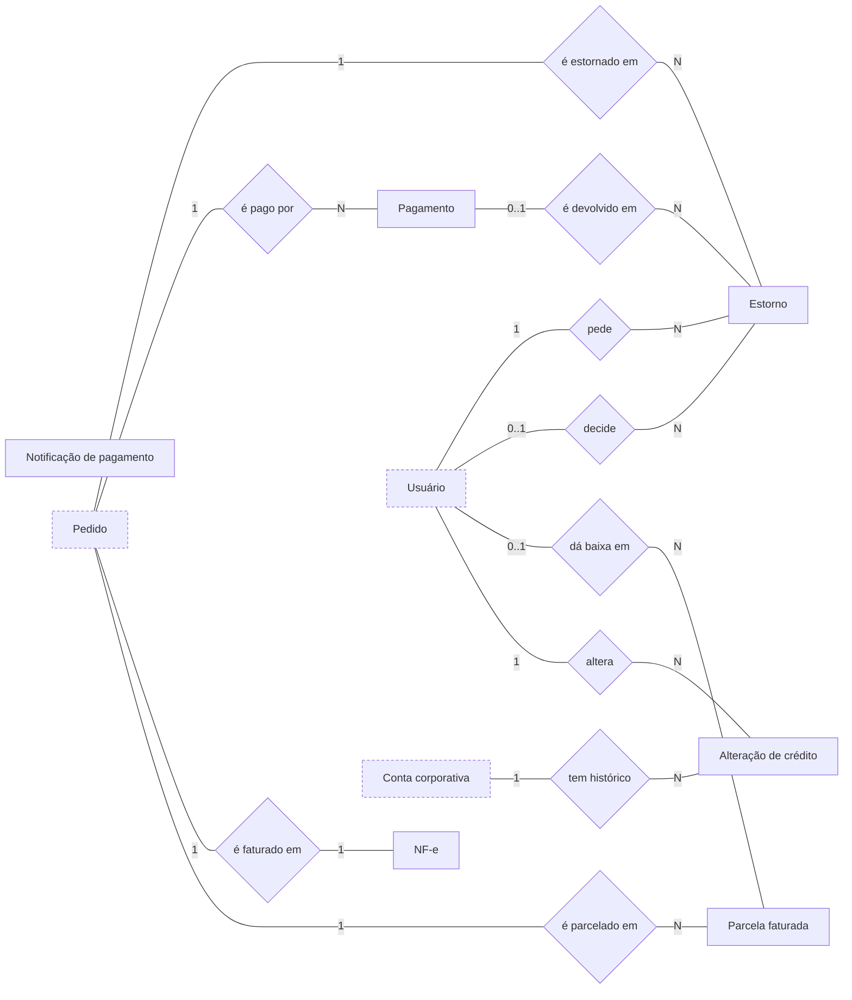
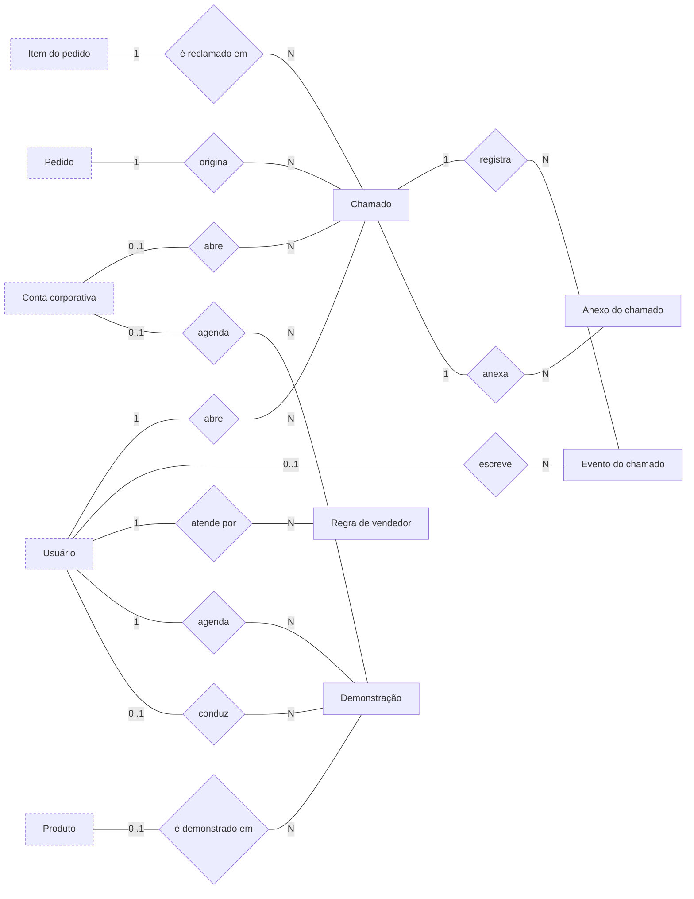
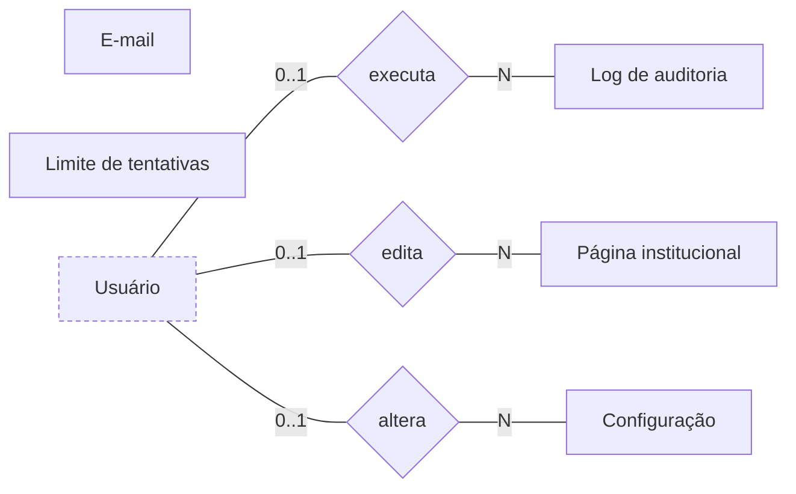

# Atelier Bureau — DER (modelo conceitual)

> Gerado por `npm run db:docs` a partir do banco criado pelas migrations (`prisma/migrations`), pelas chaves estrangeiras. Fonte da verdade: [`prisma/schema.prisma`](../../prisma/schema.prisma). Não edite à mão: altere o schema ou `scripts/db-docs/descriptions.ts` e gere de novo.

Notação de Chen: retângulos são entidades, losangos são relacionamentos e o rótulo das linhas é a cardinalidade (1, N ou 0..1 quando a participação é opcional). Entidades com borda tracejada pertencem a outro domínio e aparecem só para mostrar a ligação.

O modelo tem 52 entidades, 79 relacionamentos por chave estrangeira e 7 domínios. Os atributos estão no [MER](03-mer.md) e no [dicionário de dados](04-dicionario-de-dados.md).

## Visão geral dos domínios

| Domínio | Entidades |
|---|---|
| Acesso, contas e perfis | Usuário, Sessão, Credencial, Verificação, Segundo fator, Conta corporativa, Membro, Convite, Perfil interno, Permissão, Permissão do perfil, Perfil do usuário, Endereço |
| Catálogo e estoque | Categoria, Produto, Imagem do produto, Documento do produto, SKU, Estoque, Movimento de estoque, Favorito |
| Carrinho, cotação, preços e promoções | Carrinho, Item do carrinho, Cotação, Item da cotação, Anexo da cotação, Tabela de preço, Item da tabela de preço, Desconto por volume, Promoção |
| Pedidos e logística | Pedido, Item do pedido, Histórico de status, Aprovação do pedido, Envio, Região de entrega |
| Financeiro e fiscal | Pagamento, Notificação de pagamento, Estorno, Parcela faturada, NF-e, Alteração de crédito |
| Pós-venda e atendimento | Chamado, Evento do chamado, Anexo do chamado, Regra de vendedor, Demonstração |
| Plataforma e auditoria | Configuração, Página institucional, Log de auditoria, E-mail, Limite de tentativas |

A seta vai do domínio referenciado para o domínio que guarda a chave estrangeira.

## Acesso, contas e perfis

## Catálogo e estoque

## Carrinho, cotação, preços e promoções

## Pedidos e logística

## Financeiro e fiscal

## Pós-venda e atendimento

## Plataforma e auditoria

