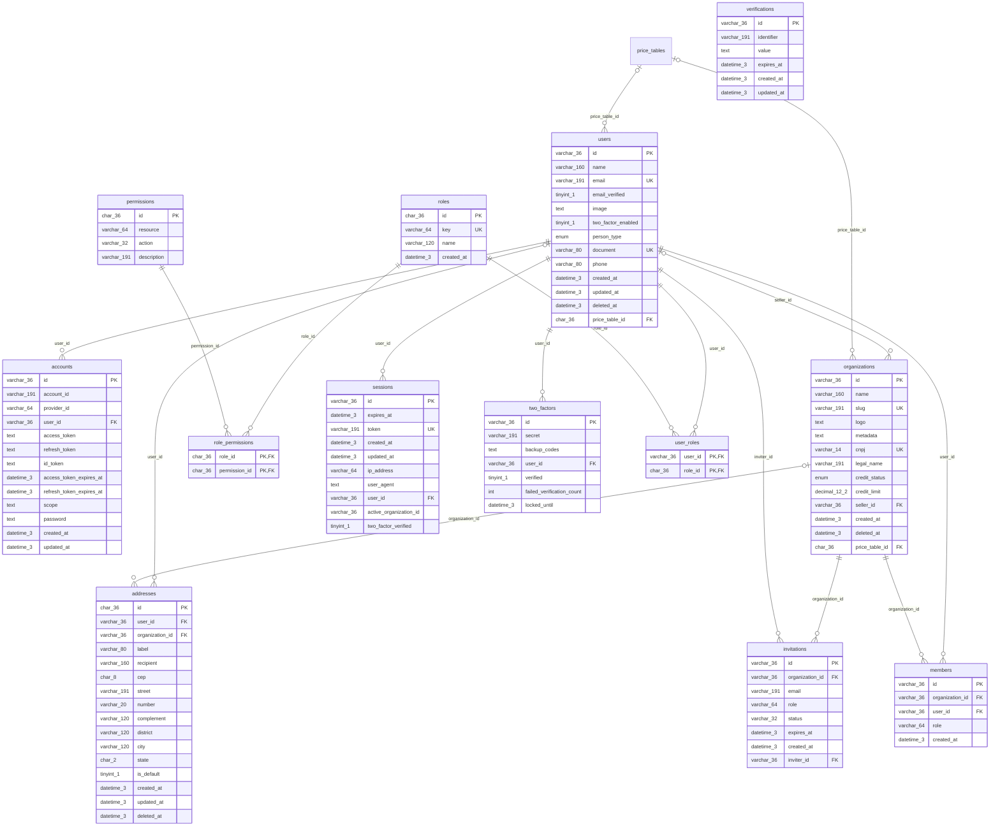
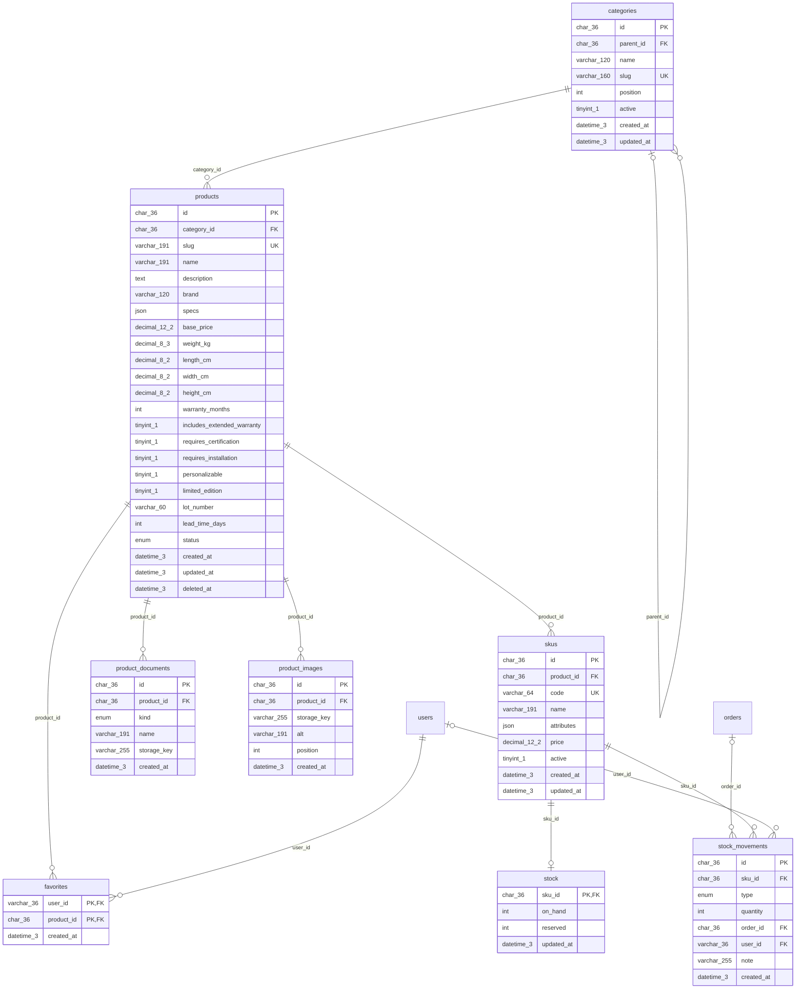
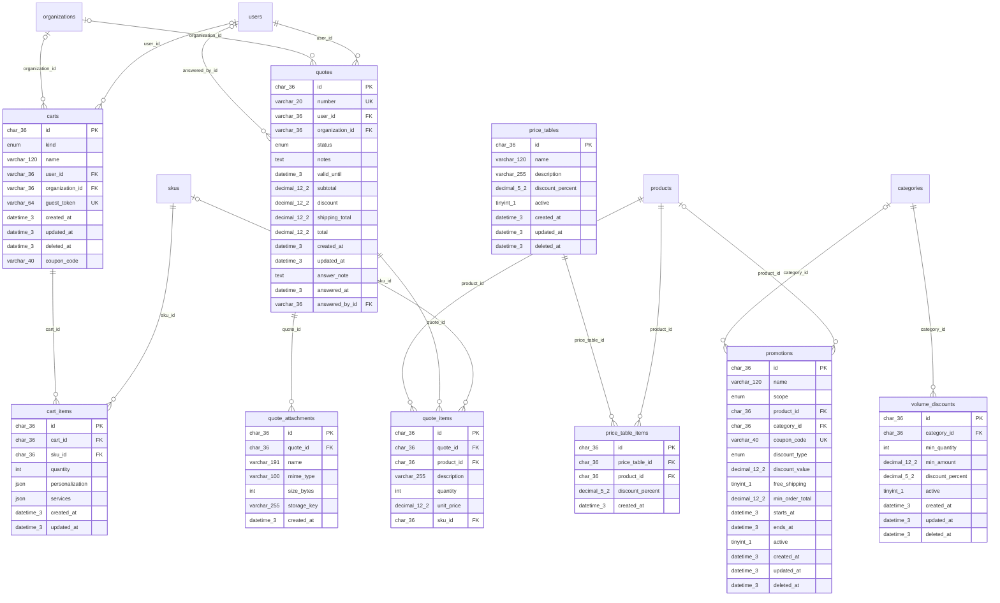
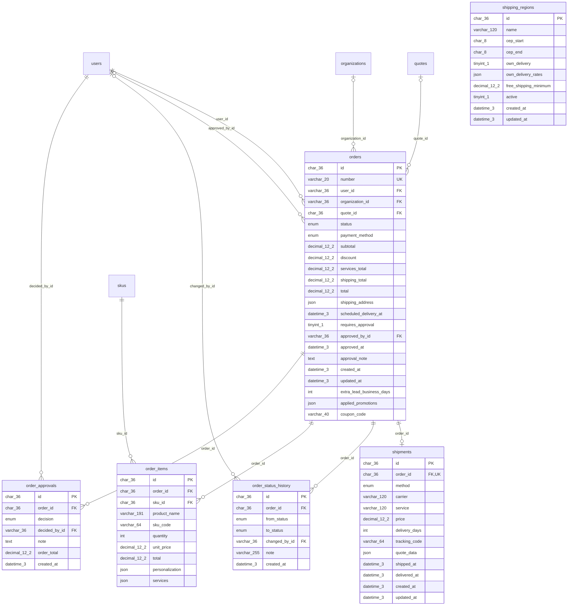
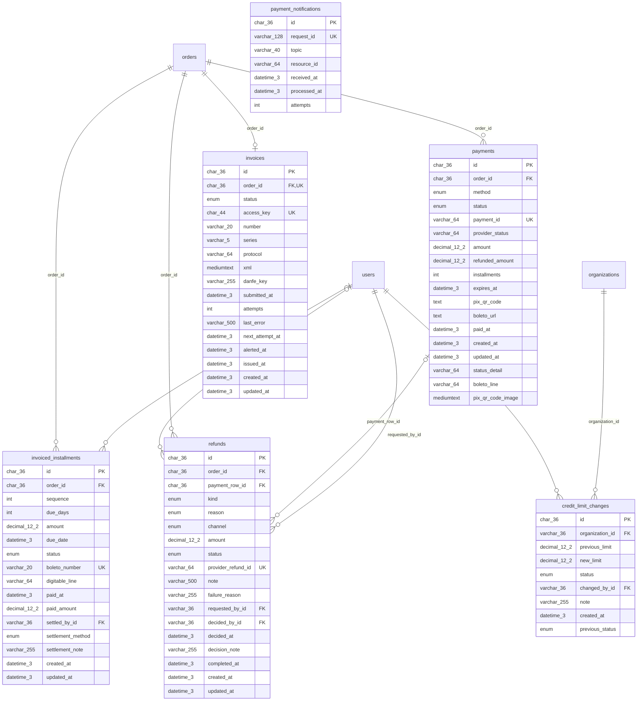
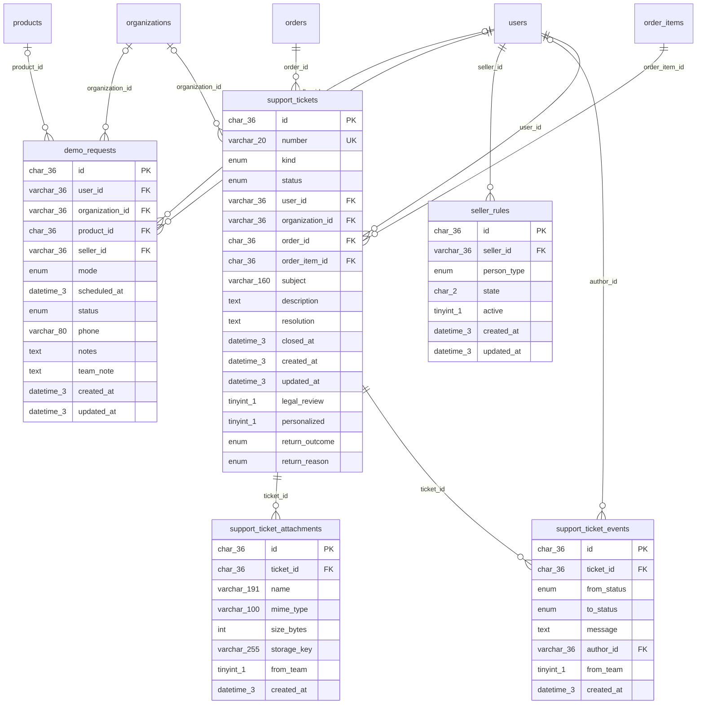
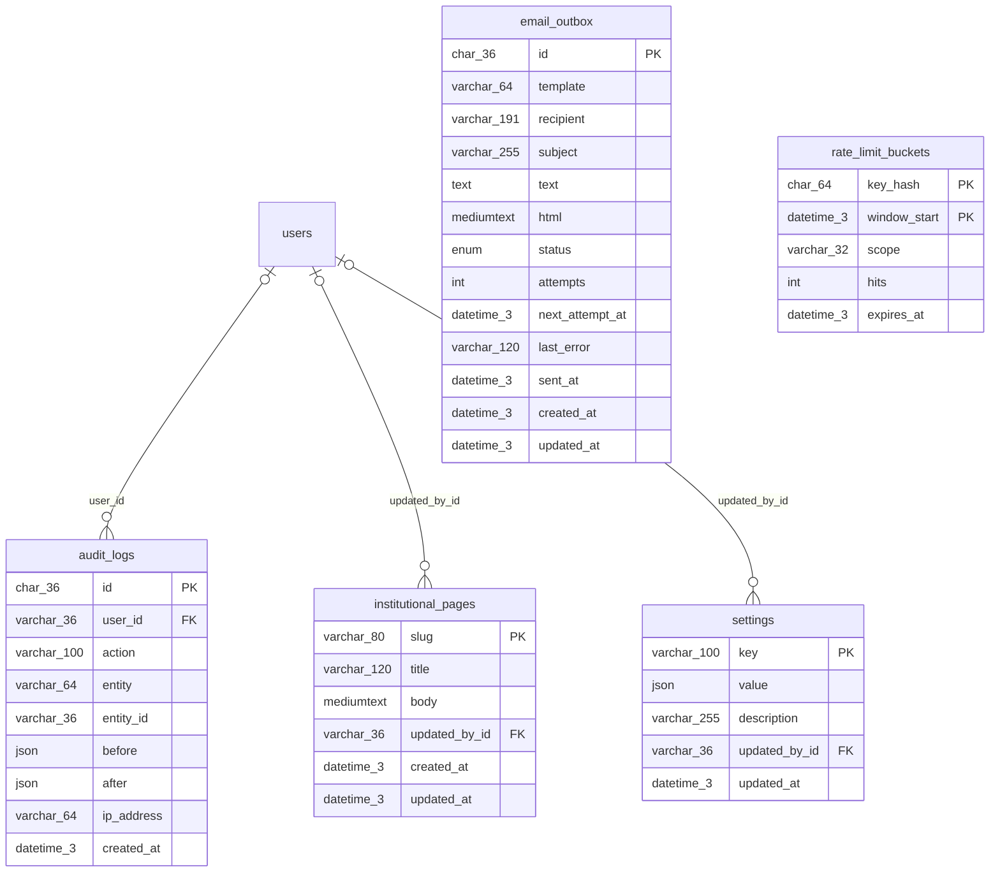

# Atelier Bureau — MER (modelo lógico)

> Gerado por `npm run db:docs` a partir do banco criado pelas migrations (`prisma/migrations`). Fonte da verdade: [`prisma/schema.prisma`](../../prisma/schema.prisma). Não edite à mão: altere o schema ou `scripts/db-docs/descriptions.ts` e gere de novo.

Notação pé de galinha: `||` exatamente um, `|o` zero ou um, `o{` zero ou muitos e `o|` zero ou um do lado filho (relação 1:1). O rótulo da linha é a coluna de chave estrangeira. Tipos abreviados: `varchar_191` = `VARCHAR(191)`, `decimal_12_2` = `DECIMAL(12,2)` e `datetime_3` = `DATETIME(3)`.

Tabelas de outros domínios aparecem sem atributos, só para mostrar a ligação. O detalhe de cada coluna está no [dicionário de dados](04-dicionario-de-dados.md).

## Acesso, contas e perfis

## Catálogo e estoque

## Carrinho, cotação, preços e promoções

## Pedidos e logística

## Financeiro e fiscal

## Pós-venda e atendimento

## Plataforma e auditoria

